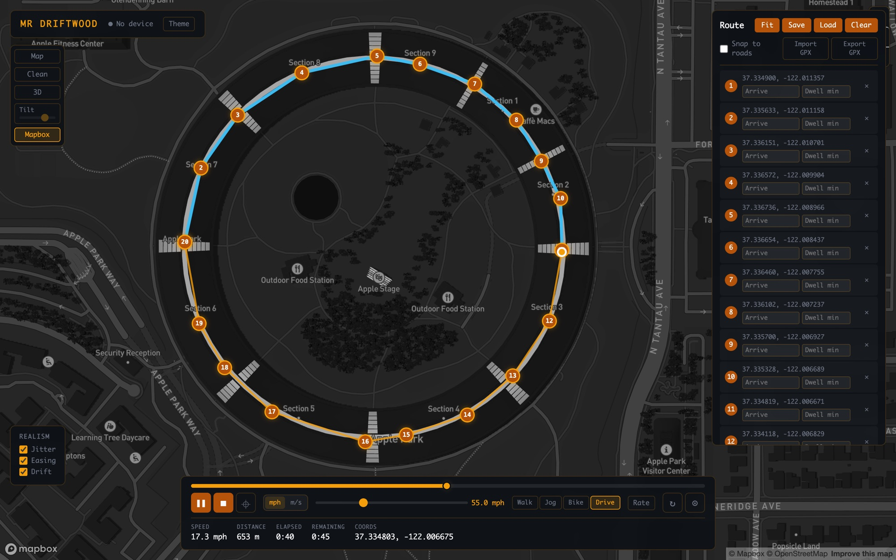
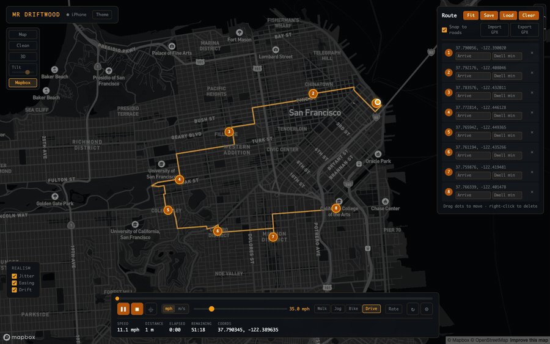

# MR Driftwood

Have you been struggling with your performativity?

Need to convince your friends that you do cool things on the weekends? Want your life360 and findMy groups to believe you went on a dangerous journey to Antarctica while you were, in fact, working on CS107E in your dorm room? 
Have you considered lying with infrastructure?

Well... look no further
MR Driftwood is a local GPS route simulator for iOS. Draw a route on a map, plug in your iPhone, press play, and watch your device confidently wander the earth without you.

<table>
  <tr>
    <td width="72%"></td>
    <!-- add docs/screenshot-phone.png (pymobiledevice3 developer dvt screenshot docs/screenshot-phone.png) and uncomment:
    <td width="28%"></td>
    -->
  </tr>
  <tr>
    <td align="center"><sub>Driving a lap of Apple Park. Blue is where the phone has been.</sub></td>
    <!-- <td align="center"><sub>Meanwhile, on the phone.</sub></td> -->
  </tr>
</table>


## What It Does

Draw GPS routes on a map. Walk your iPhone along them in real time over USB. No Xcode, no apps on the phone, no cloud.

- Draw routes on a map
- Snap paths to roads
- Simulate walking, jogging, biking, or driving
- Add pauses at waypoints
- Standstill mode: pin the phone to one spot (paste coords or pick on the map)
- Stream location updates to an iPhone over USB
- Save and replay routes

### Drive a city like you mean it



Turn on **Snap to roads** with the **Drive** preset and the route sticks to drivable streets, following one-ways and turn restrictions instead of cutting through buildings. Blue is the path the phone has driven so far, at a steady 35 mph (GIF is sped up ~60×).

## Controls

| Action | How |
| --- | --- |
| Add waypoint | Click the map |
| Move waypoint | Drag the dot |
| Delete waypoint | Right-click the dot, or `×` in the route panel |
| Undo last waypoint | `Cmd/Ctrl + Z` |
| Play / pause | `Space` |
| Stop (releases the phone) | `Esc` |
| Standstill | `⌖` button → paste `lat, lon` or **Pick on map** |
| Tilt / orbit 3D | `Shift` + scroll / `Cmd` + scroll |


## Setup

Enable Developer Mode on your iPhone

```bash
pip install -e .
cp .env.example .env
```

Driftwood now reads local settings from `.env`. Add your Mapbox public token there for Mapbox maps and routing, and keep the real `.env` out of git.

## Run (One Terminal)

```bash
sudo -v
sudo -n "$(which python3)" -m pymobiledevice3 remote tunneld >/tmp/driftwood-tunneld.log 2>&1 &
TUNNEL_PID=$!
driftwood serve
kill $TUNNEL_PID
```

Open [http://127.0.0.1:7777](http://127.0.0.1:7777)

## CLI

```bash
driftwood devices                          # list connected iPhones
driftwood run --route myroute --speed 1.4  # headless playback
driftwood hold 37.7749, -122.4194          # pin the phone to one spot (server must be running)
driftwood stop                             # stop playback / release the phone
```

## Tests

```bash
pip install pytest
pytest
```

## Stack

Python (FastAPI, pymobiledevice3) · Vanilla JS · Mapbox GL JS · No build step

## For Those Pesky Windows Users

Here is a setup that should work.

```powershell
py -m pip install -e .
Start-Process powershell -Verb RunAs -ArgumentList '-NoExit','-Command','py -m pymobiledevice3 remote tunneld'
py -m driftwood.cli serve
```

Install iTunes from the Microsoft Store first:
<https://apps.microsoft.com/detail/9pb2mz1zmb1s?hl=en-US&gl=US>

Then open <http://127.0.0.1:7777>. On iOS 17.0-17.3.1, `pymobiledevice3` notes that Windows may also need additional drivers.
